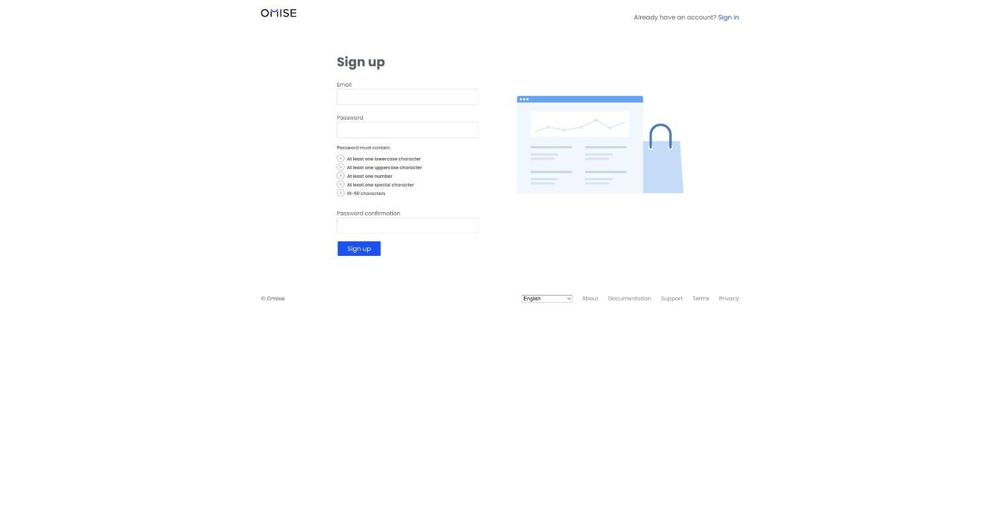
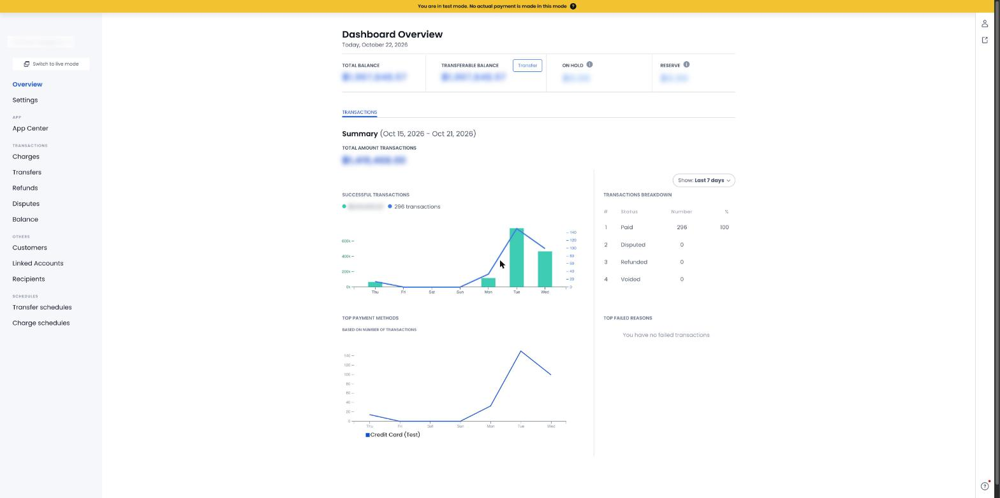
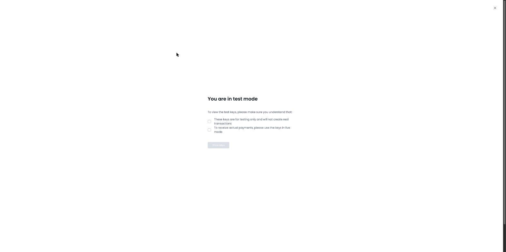
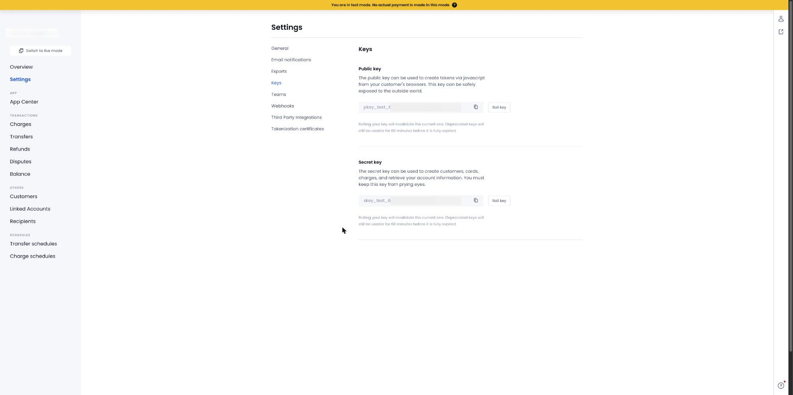
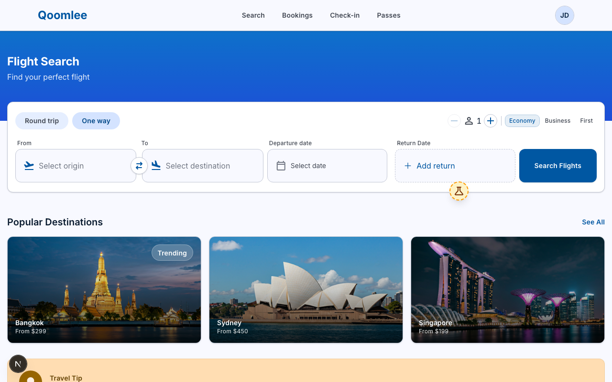

# Prerequisites

Do these **before the first session**. It takes about 30–45 minutes (mostly downloads).
Each step ends with a **✅ Done when** check. If a check doesn't match, don't move on: see [Troubleshooting](#troubleshooting).

| # | Step | You'll have |
|---|------|-------------|
| 1 | [Omise account + test keys](#1-omise-account-and-test-keys) | `pkey_test_…` and `skey_test_…` |
| 2 | [Install Node, Bun, Docker](#2-install-node-bun-docker) | `node`, `bun`, `docker` working in your terminal |
| 3 | [Get the code](#3-get-the-code) | The repo on your machine |
| 4 | [Create your `.env` files](#4-create-your-env-files) | Keys wired into the app |
| 5 | [Final check](#5-final-check) | The app running and Playwright installed |

> Commands below are for a terminal: **Terminal** on macOS/Linux, **PowerShell** on Windows (WSL2 also works).
> Lines starting with `$` are what you type; don't type the `$`.

---

## 1. Omise account and test keys

The app takes card payments through [Omise](https://www.omise.co). We only use **test mode**: no real money, no real cards, no business documents needed.

### 1.1 Sign up

1. Open <https://dashboard.omise.co/signup>.
2. Enter your email and a password (10–50 characters with a lowercase letter, an uppercase letter, a number and a special character), repeat it in **Password confirmation**, then click **Sign up**.
3. Open the verification email from Omise and click the link to confirm your address.
4. Sign in at <https://dashboard.omise.co>. If it asks you to create an account/business, use any name (for example `Playwright Course`), and pick **Thailand** if asked for a country.
   You do **not** need to activate live mode or submit documents.



**✅ Done when:** you can sign in and see the Omise dashboard.

### 1.2 Make sure you are in Test mode

A new account opens in **Test mode**. You can tell by the yellow banner at the top of the dashboard: *"You are in test mode. No actual payment is made in this mode"*. The sidebar button says **Switch to live mode**, which means you are currently in test mode. **Do not click it.**



**✅ Done when:** the yellow test-mode banner is visible.

### 1.3 Copy your test keys

1. In the left sidebar click **Settings**, then the **Keys** tab.
2. Omise asks you to confirm you understand the keys are for testing only. Tick both boxes and click **Show keys**.

   

3. You'll see two keys. Use the copy icon next to each:
   - **Public key**: starts with `pkey_test_`
   - **Secret key**: starts with `skey_test_`
4. Paste both into a scratch note for now. You need them in [step 4](#4-create-your-env-files).



**✅ Done when:** you have two strings: one starting `pkey_test_`, one starting `skey_test_`.

> ⚠️ Keys starting with `pkey_` / `skey_` **without** `test` are LIVE keys. Never use them in this course.
> The secret key is a password: don't commit it, post it in chat, or screenshot it publicly.

---

## 2. Install Node, Bun, Docker

| Tool | What it's for | Needed version |
|------|---------------|----------------|
| Node.js | Runs Playwright's CLI and tooling | 20 or newer (LTS recommended) |
| Bun | Installs packages and runs the web app (`bun install`, `bun run dev`) | any recent 1.x |
| Docker Desktop | Runs the Postgres databases and backend services | Docker Compose v2 (`docker compose`, not `docker-compose`) |

### 2.1 Node.js

- **macOS (Homebrew):** `brew install node`
- **Windows:** download the **LTS** installer from <https://nodejs.org> and run it with the defaults.
- **Linux:** use your package manager or <https://nodejs.org/en/download>.

Open a **new** terminal window, then run:

```bash
$ node --version
```

**✅ Done when:** it prints `v20.x.x` or higher (for example `v22.11.0`).

### 2.2 Bun

- **macOS / Linux / WSL:** `curl -fsSL https://bun.sh/install | bash`
- **macOS (Homebrew):** `brew install oven-sh/bun/bun`
- **Windows (PowerShell):** `powershell -c "irm bun.sh/install.ps1 | iex"`

Close the terminal and open a **new** one (so `bun` is on your PATH), then run:

```bash
$ bun --version
```

**✅ Done when:** it prints a version such as `1.2.x`.

### 2.3 Docker Desktop

1. Download from <https://www.docker.com/products/docker-desktop> and install it.
   - macOS: pick **Apple Silicon** or **Intel** to match your Mac (Apple menu → About This Mac).
   - Windows: accept the **WSL 2** option if the installer offers it; restart if asked.
2. **Start Docker Desktop** and wait until the whale icon says it is running (the bottom-left status in the app turns green).
3. Check it from a terminal:

```bash
$ docker --version
$ docker compose version
$ docker run --rm hello-world
```

**✅ Done when:** the last command prints `Hello from Docker!`.

> 📸 _Screenshot to add: Docker Desktop showing "running"_ (`docs/prerequisites/04-docker-running.png`)

> If `docker run` says *"Cannot connect to the Docker daemon"*, Docker Desktop isn't running yet. Open it and wait a minute.

---

## 3. Get the code

```bash
$ git clone https://github.com/anuchito/course-playwright.git
$ cd course-playwright/qoomlee
$ git checkout demo
```

**✅ Done when:** `ls` shows `app`, `infra`, `services`, `docker-compose.yml`, `.env.example`, `Makefile`.

> No `git`? Install it from <https://git-scm.com/downloads>, then retry.

---

## 4. Create your `.env` files

Two files hold configuration. Both are created by **copying an example file**, then editing.
The real `.env` files are git-ignored, so your keys never get committed.

### 4.1 Backend: `qoomlee/.env` (holds your Omise keys)

From inside `course-playwright/qoomlee`:

```bash
# macOS / Linux / WSL / Git Bash
$ cp .env.example .env
```

```powershell
# Windows PowerShell
> Copy-Item .env.example .env
```

Open `.env` in any editor (VS Code: `code .env`). Change **only these two lines**, pasting the keys from [step 1.3](#13-copy-your-test-keys):

```diff
-OMISE_PUBLIC_KEY=pkey_test_xxxxxxxxxxxxxxxxxxxxxx
-OMISE_SECRET_KEY=skey_test_xxxxxxxxxxxxxxxxxxxxxx
+OMISE_PUBLIC_KEY=pkey_test_<your public key>
+OMISE_SECRET_KEY=skey_test_<your secret key>
```

Rules:
- No quotes, no spaces around `=`, no trailing spaces.
- Leave every other line (database names, `INTERNAL_TOKEN`, `ALLOWED_ORIGINS`) as it is.

**✅ Done when:** this prints two lines starting `pkey_test_` and `skey_test_` and **no** `xxxx`:

```bash
$ grep OMISE .env
```

(Windows PowerShell: `Select-String OMISE .env`)

**Optional but recommended: check Omise accepts your secret key** (macOS / Linux / WSL / Git Bash; it never prints the key):

```bash
$ set -a; . ./.env; set +a
$ curl -s -u "$OMISE_SECRET_KEY:" https://api.omise.co/account
```

**✅ Done when:** the JSON reply contains `"object":"account"`. If it contains `"code":"authentication_failure"`, the key was copied wrong.

### 4.2 Web app: `qoomlee/app/web/.env.local`

```bash
$ cp app/web/.env.example app/web/.env.local
```

```powershell
> Copy-Item app/web/.env.example app/web/.env.local
```

No edits needed: the defaults already point at the local backend (`localhost:9988` and `localhost:9984`). The Omise keys live only in the backend `.env` from 4.1, and the secret key must never go into a `NEXT_PUBLIC_*` variable (those are bundled into the browser).

**✅ Done when:**

```bash
$ cat app/web/.env.local
```

shows four lines starting `NEXT_PUBLIC_`.

---

## 5. Final check

Run these from `course-playwright/qoomlee`. Each one has an expected result.

### 5.1 Install web dependencies

```bash
$ make install
```

(No `make`? Use `cd app/web && bun install`.)

**✅ Done when:** it finishes without `error:` lines.

### 5.2 Install Playwright's browsers

```bash
$ cd app/web
$ bunx playwright install chromium
$ cd ../..
```

**✅ Done when:** it finishes without errors (it may say the browser is already installed; that's fine).

> Linux only: if a later test says system libraries are missing, run `bunx playwright install --with-deps chromium`.

### 5.3 Start the backend

Docker Desktop must be running.

```bash
$ make up
```

The first run downloads images and builds the services, so it can take a few minutes.

**✅ Done when:** the command returns to the prompt and `make status` prints two health responses (no "connection refused"):

```bash
$ make status
```

### 5.4 Start the web app

In a **second** terminal:

```bash
$ cd course-playwright/qoomlee
$ make web
```

**✅ Done when:** the terminal shows `Ready` and <http://localhost:3000> opens the Qoomlee booking page in your browser.



### 5.5 Run the sample test

In your first terminal:

```bash
$ make test-ui
```

This uses a mocked backend and starts the web app by itself if it isn't running. Playwright's Chromium is enough; no other browser is needed.

**✅ Done when:** the summary says all tests **passed** (green), with 0 failed.

### 5.6 Run the real end-to-end test (proves your Omise keys)

With `make up` and `make web` still running:

```bash
$ make test-e2e
```

This books a flight and pays with Omise's test card (`4242 4242 4242 4242`), so it only passes if your keys and Docker backend are correct.

**✅ Done when:** the summary says all tests **passed**, with 0 failed. An HTML report is written to `app/web/playwright-report/`.

🎉 If 5.1–5.6 all passed, you are ready for the course.
To stop everything afterwards: `Ctrl+C` in the web terminal, then `make down`.

---

## Troubleshooting

| Symptom | Fix |
|---------|-----|
| `command not found: node / bun` right after installing | Close the terminal and open a new one so the PATH refreshes. |
| `Cannot connect to the Docker daemon` | Start Docker Desktop and wait until it reports running. |
| `make up` fails with `port is already allocated` (9933, 9934, 9984, 9988) | Another program uses the port. Stop it, or run `docker ps` to find an old container and `docker compose down`. |
| `make up` warns `OMISE_PUBLIC_KEY variable is not set` | `.env` is missing or in the wrong folder. It must be `qoomlee/.env`, next to `docker-compose.yml`. |
| Payment step fails with an Omise authentication error | A key was copied wrong or from **Live** mode. Re-copy both from the **Test** keys page and run `make reset`. |
| Changed `.env` but nothing changed | Re-run `make up` (backend). For `app/web/.env.local`, stop and restart `make web`. |
| `make: command not found` (Windows) | Use WSL2, or run the equivalent: `make up` → `docker compose up -d --build --wait`; `make web` → `cd app/web && bun run dev`; `make test-ui` → `cd app/web && bun run test:ui`; `make test-e2e` → `cd app/web && bun run test:e2e`. |
| `make up` is very slow or Docker is killed | Give Docker Desktop at least 4 GB RAM (Settings → Resources) and keep ~5 GB of disk free. |
| Port 3000 is already in use | Stop the other program using it (the tests expect exactly `http://localhost:3000`). |
| `make test-e2e` fails but `make test-ui` passes | The backend isn't healthy or the Omise keys are wrong. Run `make status`, redo the key check in 4.1, then `make reset`. |
| Playwright says a browser executable doesn't exist | Run `bunx playwright install chromium` inside `app/web`. |

Still stuck? Post the **exact command** and the **full error text** in the course chat (never paste your `skey_` key).
